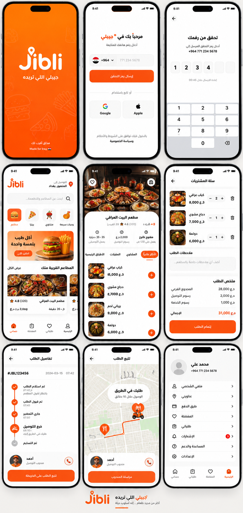
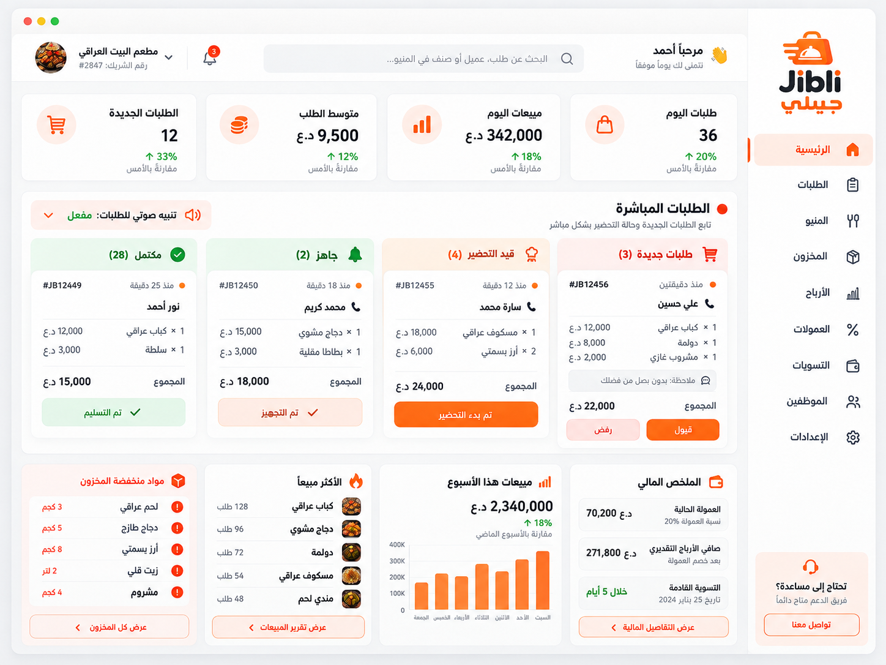
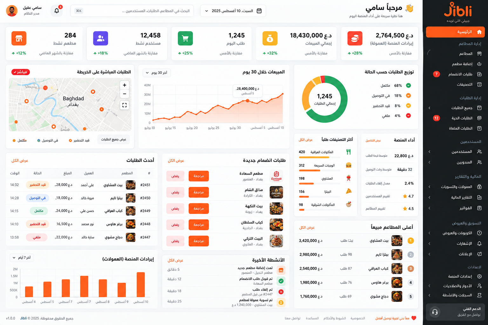
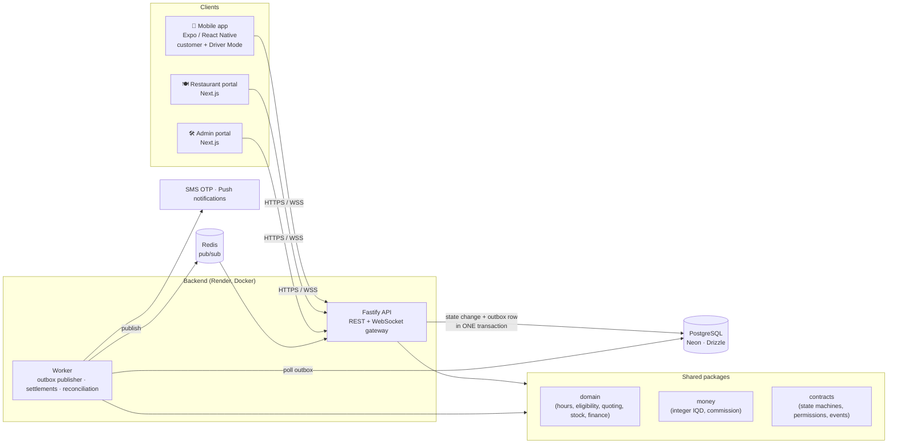
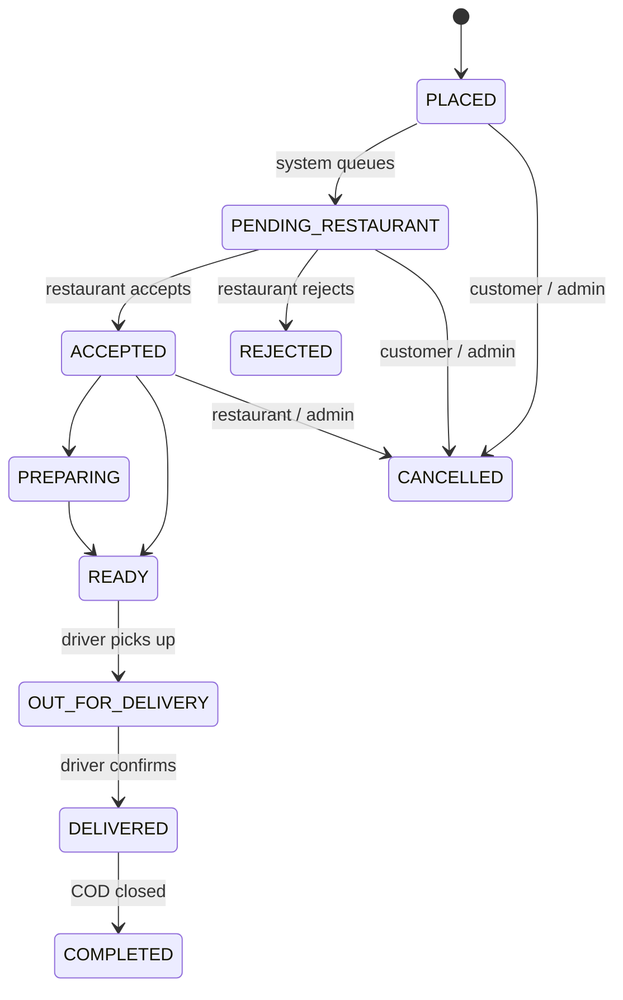

<div align="center">

# Jibli — Food Delivery Platform for Iraq

**Customer app with Driver Mode · Restaurant portal · Admin portal · API · Background worker**
One TypeScript monorepo, built for production rather than for a demo.

[](https://github.com/sami7q/jibli-app/actions/workflows/ci.yml)


**[Live restaurant portal →](https://jibli-partner.vercel.app)** &nbsp;·&nbsp; [Architecture](#architecture) &nbsp;·&nbsp; [Run locally](#run-locally) &nbsp;·&nbsp; [Tests](#tests) &nbsp;·&nbsp; [Design decisions](#design-decisions)

</div>

---

## What it is

Jibli is a food-delivery platform for the Iraqi market: customers order from restaurants, restaurant-owned drivers deliver, payment is cash on delivery and the platform takes a commission settled twice a month. The interface is Arabic-first (RTL).

| App                   | Stack               | Who uses it                                                      |
| --------------------- | ------------------- | ---------------------------------------------------------------- |
| `apps/mobile`         | Expo / React Native | Customers — and drivers, through **Driver Mode** in the same app |
| `apps/restaurant-web` | Next.js             | Restaurants: live orders, menu, stock, staff, drivers, earnings  |
| `apps/admin-web`      | Next.js             | Operations: cities, restaurants, commissions, settlements        |
| `apps/api`            | Fastify + WebSocket | REST API and realtime gateway                                    |
| `apps/worker`         | Node.js             | Transactional outbox, settlements, reconciliation                |
| `apps/legal`          | Next.js             | Privacy policy and terms pages                                   |

13 shared packages hold the actual business rules: `domain`, `money`, `contracts`, `db`, `auth`, `geography`, `validation`, `notifications`, `config`, `logger`, `design-tokens`, `ui-web`, `test-utils`.

## Screenshots

> UI design of the three client surfaces (Arabic, RTL).

| Customer app                                                                   | Restaurant portal                                                                          | Admin portal                                                                     |
| ------------------------------------------------------------------------------ | ------------------------------------------------------------------------------------------ | -------------------------------------------------------------------------------- |
|  |  |  |

## Architecture



**The layering rule:** business logic lives in `packages/domain` and `packages/money`, never in a route handler or a React component. Controllers authenticate, authorise, validate, call a use case and return a structured response.

### Order lifecycle



Transitions — and which actor may perform each one — are declared once in `packages/contracts/src/state-machines.ts`. No endpoint accepts a free-form status string.

## Design decisions

The interesting part of this codebase is what it makes **impossible**. Most rules are enforced by the database, because application checks lose races.

| Must be impossible                         | Enforced by                                                          |
| ------------------------------------------ | -------------------------------------------------------------------- |
| A network retry creates a second order     | Unique index on `idempotency_keys (scope, key)`                      |
| An order is settled twice                  | Unique index on `settlement_lines (order_id)` across all settlements |
| Commission is recalculated at a later rate | Rate snapshotted onto the order; settlement reads the snapshot       |
| COD cash is credited twice                 | Partial unique index: one `ORDER_CASH_COLLECTED` per order           |
| Two drivers hold one delivery              | Partial unique index on active `delivery_assignments (driver_id)`    |
| Concurrent orders oversell stock           | Row lock + `SELECT … FOR UPDATE` on the inventory row                |
| An order total disagrees with its parts    | `CHECK` constraint on `orders`                                       |
| A stale client orders in a disabled city   | City capability re-checked inside the PlaceOrder transaction         |

Other decisions, each written up as an ADR in [`docs/adr`](docs/adr):

- **Modular monolith** over microservices — one deployable API, clear package boundaries ([ADR-0001](docs/adr/0001-modular-monolith.md)).
- **Integer money only** — IQD has no decimals here; `packages/money` refuses floats and uses one half-up rounding policy, so a restaurant owner can reproduce a statement on a calculator ([ADR-0002](docs/adr/0002-integer-money.md)).
- **Transactional outbox** — the state change and its event commit together; realtime being down delays an alert but never loses an order ([ADR-0004](docs/adr/0004-transactional-outbox.md)).
- **No live GPS in release 1** — presence heartbeat only; navigation hands off to Google Maps / Waze ([ADR-0005](docs/adr/0005-no-live-gps.md)).

## Tech stack

**Mobile:** Expo, React Native, TanStack Query, Sentry, Expo Notifications · **Web:** Next.js, React, TanStack Query, Zod · **API:** Fastify, `@fastify/websocket`, `@fastify/rate-limit`, Helmet, JOSE (JWT), Argon2 · **Data:** PostgreSQL (Neon), Drizzle ORM + SQL migrations, Redis · **Tooling:** pnpm workspaces, TypeScript strict, ESLint, Prettier, Vitest, GitHub Actions, Docker, esbuild bundles · **Hosting:** Render (API, worker), Vercel (portals)

## Run locally

Requirements: Node 20.19+, pnpm 9+, Docker.

```bash
git clone https://github.com/sami7q/jibli-app.git && cd jibli-app
pnpm install
cp .env.example .env              # fill in the secrets

pnpm infra:up                     # PostgreSQL, Redis, MinIO (Docker)
pnpm db:migrate                   # apply SQL migrations
pnpm db:seed                      # 19 governorates, 115 cities, config defaults

pnpm dev:api                      # http://localhost:4000
pnpm dev:worker
pnpm dev:restaurant               # http://localhost:3000
pnpm dev:admin                    # http://localhost:3001
pnpm dev:mobile                   # Expo
```

The development seed opens **Baghdad** so a fresh database is usable immediately. In local development the console OTP provider returns the code in the API response (`dev_code`), so you can sign in without an SMS gateway; it never does this in any other environment.

## Tests

```bash
pnpm test                 # unit tests (Vitest) — 718 test cases
pnpm test:coverage        # coverage, with enforced thresholds on money and geography
pnpm test:e2e             # end-to-end API flows
pnpm typecheck && pnpm lint
pnpm deploy:check         # typecheck + lint + test + build + bundle — what CI runs
```

## Repository layout

```text
apps/       api · worker · mobile · restaurant-web · admin-web · legal
packages/   domain · money · contracts · db · auth · geography · validation
            notifications · config · logger · design-tokens · ui-web · test-utils
docs/       adr · architecture · api · finance · security · operations · mobile
infra/      docker (local Postgres/Redis/MinIO, service Dockerfile)
```

## Status

Pre-launch. API and worker run on Render, portals on Vercel; the Android app is being prepared for Google Play release.

---

<div align="center">

Built by **Sami Aqeel** · [LinkedIn](https://www.linkedin.com/in/sami-sami-496a33231/) · [GitHub](https://github.com/sami7q) · sami22eng@gmail.com

</div>
